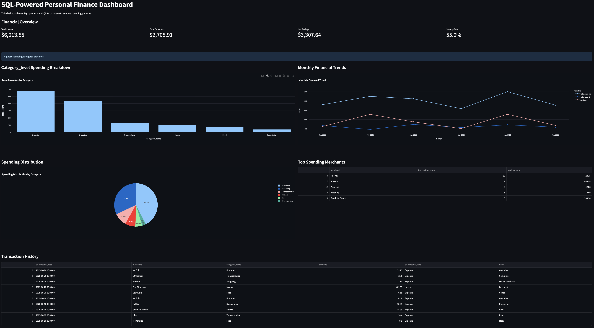
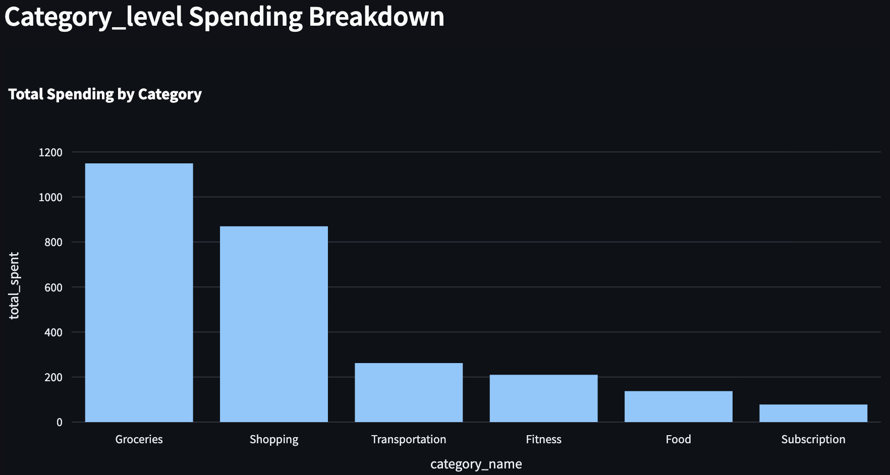
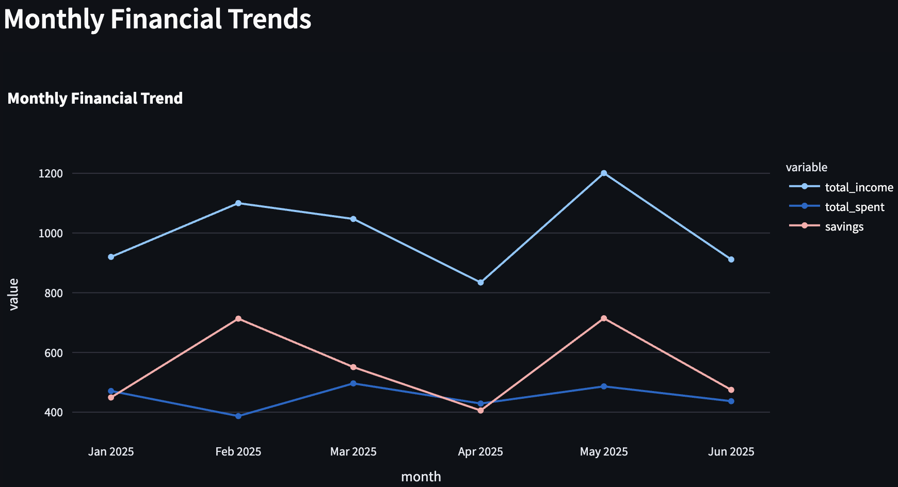
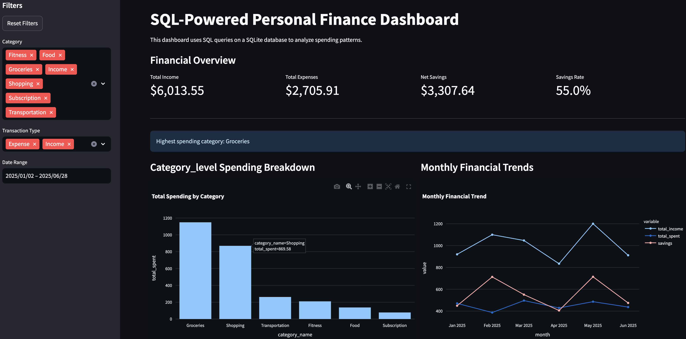

# SQL-Powered Personal Finance Dashboard

> Based on the MIT-licensed project by Karmeen Desai. See [LICENSE](LICENSE) for attribution and license terms.

An end-to-end data analytics project that transforms raw transaction data into actionable financial insights using SQL, Python, and interactive visualization.

This project demonstrates the complete analytics pipeline from raw data ingestion to interactive dashboard visualization.

---

## Key Features

- Built a **relational SQLite database** from transaction-level data
- Wrote reusable **SQL queries** to compute financial metrics
- Developed an **interactive Streamlit dashboard**
- Implemented dynamic **filters** (category, transaction type, date range)
- Computed key financial KPIs:
    - Total Income
    - Total Expenses
    - Net Savings
    - Savings Rate
- Visualized:
    - Category-level spending breakdown
    - Monthly Income vs Expenses vs Savings Trends
    - Spending distribution
    - Top merchants by spend
- Designed for **interactive exploration of financial trends and spending behavior**

---

## Screenshots

### Dashboard Overview


### Monthly Spending by Category


### Monthly Financial Trends


### Interactive Filters


---

## Technical Highlights

- **SQL-backed design**: Transaction data is stored and queried in SQLite, with interactive filtering and analytics performed in pandas
- **Separation of concerns**:
    - `create_database.py` -> data ingestion
    - `queries.py` -> SQL logic
    - `app.py` -> visualization layer
- **Data pipeline mindset**:
    - CSV -> SQLite -> pandas -> dashboard
- Efficient use of:
    - `GROUP BY`, `SUM`, filtering
    - Monthly aggregations & pandas merges
- Built reusable SQL query functions to support modular analytics workflows

---

## Tech Stack

- **Python**
- **SQLite / SQL**
- **Pandas**
- **Streamlit**
- **Plotly**

---

## Project Structure

```text
sql-finance-dashboard/
├── app.py                      # Streamlit dashboard
├── create_database.py          # Builds SQLite database
├── queries.py                  # SQL query functions
├── requirements.txt
├── README.md
├── data/
│   ├── sample_transactions.csv
│   └── finance.db
└── screenshots/
```

## How to Run

```bash
pip install -r requirements.txt
streamlit run app.py
```
